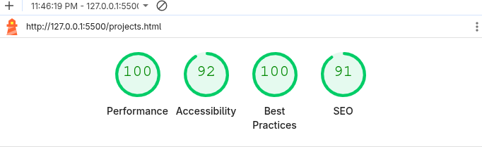
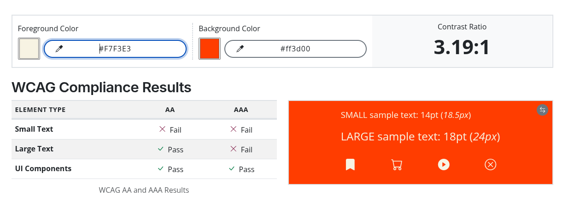
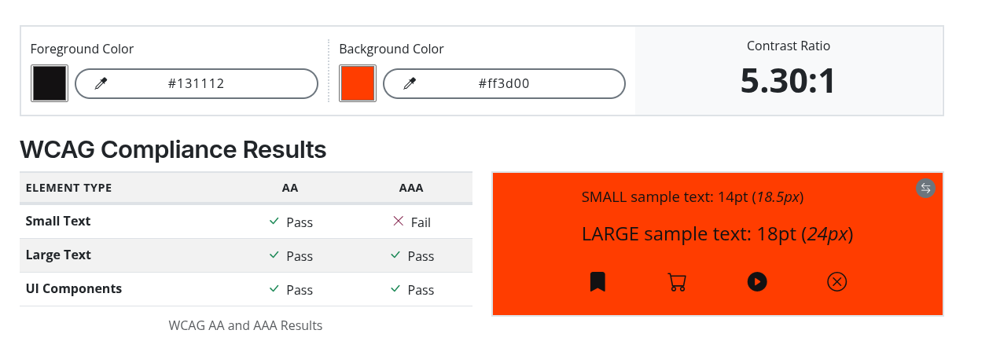
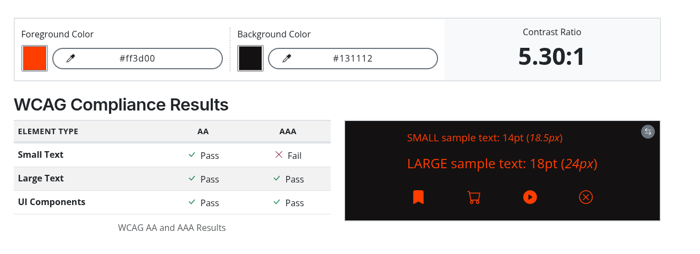
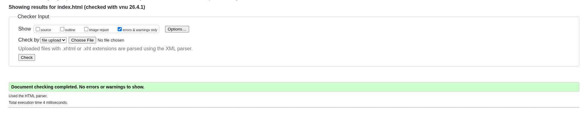
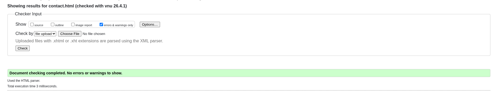

# Varshith Anthagiri - 2025111003 - A2

## Typographic Pairing

For the headings, I chose Muhaqu because it immediately grabs attention. Its tall, condensed style gives the layout a strong visual identity. It feels modern and slightly unconventional, so it helps the website stand out while still looking clean and structured.

For the body text, I used Inter because readability was the priority. It’s very easy to read on screens, even for longer paragraphs, and it doesn’t distract from the content. Compared to Muhaqu, it’s much more neutral, which actually helps balance things out.

Together, the pairing works because of the contrast in both. Muhaqu is used to add some personality while Inter is used to make the actually relevant content be readable while still matching the style.

## D3 Animations

### Hero Entrance Sequence

For the hero section, I used a staggered entrance animation to guide the user’s attention instead of overwhelming them all at once. They come in one after another so that it creates a natural reading flow and makes the landing feel more intentional.

### Scroll Triggered Section

For sections below the fold, I added a scroll-triggered animation so content reveals itself as the user reaches it. This makes the page feel more dynamic and responsive to user interaction, rather than static. I also accounted for prefers-reduced-motion so users who are sensitive to motion aren’t forced to experience unnecessary animations.

### Micro-interaction

For the theme toggle button, I used a linear timing function with a subtle scale effect on hover. The linear easing keeps the interaction feeling consistent and predictable, as I didn't want it to distract from the rest of the content.

## D4 Choices

### Group A - A2

First, I check if there is already any reading progress stored in the session, if there is I enable the prompt to scroll to it.

If a user presses yes, I retrieve the scrollDistance value and scroll to it using smooth scroll or instantly jump to it depending on if the user prefers reduced motion or not.

Then, I track scrolling by adding an event listener to the window which stores the scroll distance in the sessionStorage and also updates the reading progress bar at the top of the page.

### Group B - B1

When you construct it, you pass in an element and some settings (strings, speeds, etc.). It stores those values and sets up some internal state like the current string index, the current character position, and whether it’s running. It also prepares the DOM by creating two spans: one for the text and one for the blinking cursor.

The animation is controlled by a loop function called \_tick(). This function runs repeatedly using setTimeout. Depending on the current phase (typing, pausing, or erasing), it either adds one character, waits, or removes one character. It updates the displayed text by slicing the current string up to \_charPosition.

The start() method begins the animation by setting the phase to typing and calling \_tick(). The stop() method cancels the timer and stops everything. The \_schedule() helper is used to control timing between steps, so typing, pausing, and erasing all happen at different speeds.

Overall, it’s basically a small state machine: it cycles through typing → pause → erasing → next string, and repeats forever.

## LIGHTHOUSE

home page:

about:

contact:

project:

## CONTRAST

### light mode

light, large text:

light, small text:

### dark mode

dark, large text:

dark, small text:

### success button

both light and dark

## validator.w3.org

index.html

about.html

projects.html

contact.html

