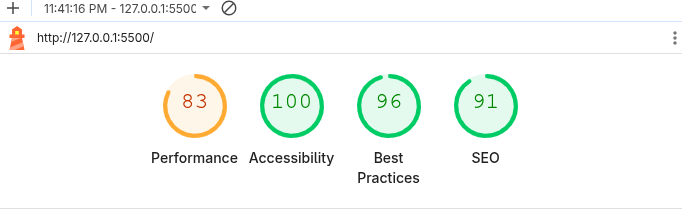
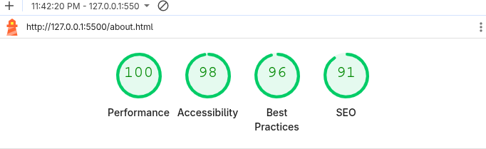

# TODO

D1:

- add actual content
- validator.w3.org

D2:

- explain fonts choice
- contrast check

D3:

- explain animation-fill-mode: both
- explain non standard easing curve (button)
- justify all animations

D4:

- write about A2, B1

D5:

- comments

D6:

- deployment

## LIGHTHOUSE

home page:

about:

contact:

project:

