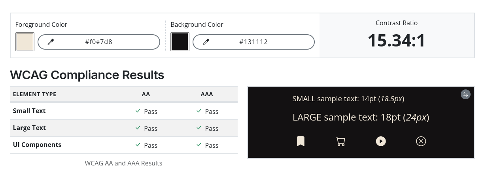
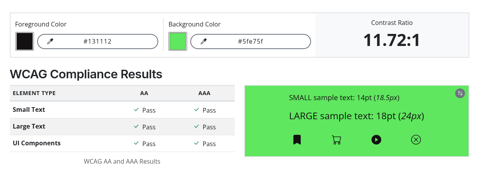

# TODO

D2:

- explain fonts choice

D3:

- explain animation-fill-mode: both
- explain non standard easing curve (button)
- justify all animations

D4:

- write about A2, B1

D5:

- comments

D6:

- deployment

## LIGHTHOUSE

home page:

about:

contact:

project:

## CONTRAST

### light mode

light, large text:

light, small text:

### dark mode

dark, large text:

dark, small text:

### success button

both light and dark

## validator.w3.org

index.html

about.html

projects.html

contact.html

